# WiseCal iOS — 화면 분석 문서

> 캡처 환경: iPhone Air Simulator (iOS 26.5), v1.0 (1)  
> 캡처 일시: 2026-06-12  
> 스크린샷 위치: `.docs/WiseCal-iOS/`

---

## 화면 목록

| # | 파일 | 화면 | 진입 방법 |
|---|------|------|-----------|
| 01 | `01_onboarding-mode_select.png` | 온보딩 1/4 — 사용 방식 선택 | 최초 실행 / 버전 업 |
| 02 | `02_onboarding-input_mode.png` | 온보딩 2/4 — 입력 모드 설명 | 다음 → |
| 03 | `03_onboarding-personal_event.png` | 온보딩 3/4 — 개인 이벤트 | 다음 → |
| 04 | `04_onboarding-integration.png` | 온보딩 4/4 — 연동 & 알림 | 다음 → |
| 05 | `05_main_calendar.png` | 메인 캘린더 | 시작하기 → |
| 06 | `06_settings.png` | 설정 | ⚙️ 버튼 |
| 07 | `07_settings-mode_picker.png` | 설정 — 입력 방식 피커 | 입력방식 행 탭 |
| 08 | `08_support.png` | 고객지원 | 설정 → 고객지원 |
| 09 | `09_support-help_center.png` | 도움말 센터 | 고객지원 → 도움말 센터 |
| 10 | `10_support-faq.png` | 자주 묻는 질문 | 고객지원 → 자주 묻는 질문 |
| 11 | `11_support-general_issues.png` | 일반적인 문제 | 고객지원 → 일반적인 문제 |
| 12 | `12_support-sync_guide.png` | 동기화 문제 해결 | 고객지원 → 동기화 문제 해결 안내서 |
| 13 | `13_support-debug_log.png` | 디버그 로그 | 고객지원 → 디버그 로그 보내기 |
| 14 | `14_event_editor-medication.png` | 개인 이벤트 에디터 — 복용 탭 | ➕ 버튼 (개인이벤트 모드) |
| 15 | `15_event_editor-appointment.png` | 개인 이벤트 에디터 — 약속 탭 | 에디터 내 약속 탭 |
| 16 | `16_event_editor-fixed.png` | 개인 이벤트 에디터 — 고정 탭 | 에디터 내 고정 탭 |
| 17 | `17_main_calendar-mode_switch.png` | 메인 캘린더 — 1회 입력방식 선택 | ➕ 롱프레스 또는 특정 제스처 |
| 18 | `18_event_editor-diary.png` | 일기 에디터 | 1회 입력방식 선택 → 일기 |
| 19 | `19_event_editor-todo.png` | 일정관리 에디터 | 1회 입력방식 선택 → 일정관리 |

---

## 온보딩 (4단계)

온보딩은 최초 설치 및 버전 업데이트 시 표시되는 풀스크린 가이드다. DEBUG 빌드에서는 매 실행마다 표시된다.

### 1/4 — 사용 방식 선택

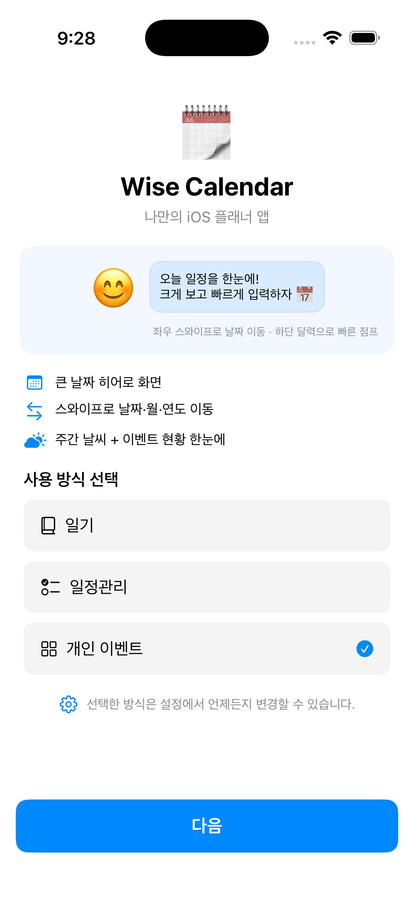

앱의 핵심 가치를 소개하고 기본 입력 방식을 고르는 첫 화면.

**구성:**
- 앱 아이콘 + 타이틀: "Wise Calendar / 나만의 iOS 플래너 앱"
- 프리뷰 배너: "오늘 일정을 한눈에! 크게 보고 빠르게 입력하자"
  - 조작 힌트: 좌우 스와이프 날짜 이동, 하단 탭 빠른 입력
- 핵심 기능 3줄:
  - 큰 날짜 히어로 화면
  - 스와이프로 날짜·월·연도 이동
  - 주간 날씨 + 이벤트 현황 한눈에
- **사용 방식 선택** (라디오, 1개 필수 — 초기값: 개인 이벤트):
  - `일기` — 전체화면 자유 텍스트 입력
  - `일정관리` — 체크리스트 + 기한 관리
  - `개인 이벤트` ✓ — 복용·약속·고정 템플릿
- **다음** CTA 버튼

### 2/4 — 입력 모드 설명

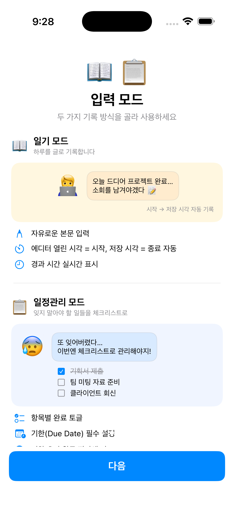

일기 모드와 일정관리 모드의 차이를 예시와 함께 설명.

**일기 모드:**
- 하루를 글로 기록
- 자유로운 본문 입력
- 에디터 열린 시각 = 시작, 저장 시각 = 종료 자동 기록
- 경과 시간 실시간 표시

**일정관리 모드:**
- 맞아야 할 일들을 체크리스트로
- 항목별 완료 토글
- 기한(Due Date) 필수 설정

### 3/4 — 개인 이벤트

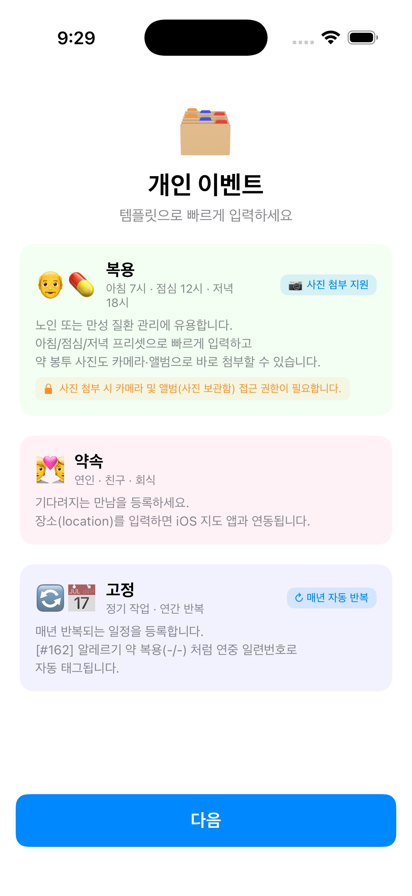

템플릿 기반 빠른 입력 방식 소개. 분류는 복용 / 약속 / 고정.

| 분류 | 특징 |
|------|------|
| **복용** | 아침/점심/저녁 프리셋, 사진 첨부 지원(카메라 및 앨범 권한), 약 봉투 사진 연동 |
| **약속** | 연인·친구·회식, 장소(Location) 입력 시 iOS 지도 앱 연동 |
| **고정** | 정기 작업·연간 반복, `[#162]` 형식 알림 자동 연번 태그 |

### 4/4 — 연동 & 알림

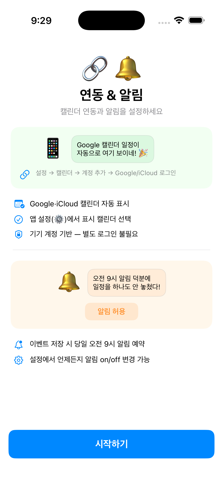

캘린더 연동과 알림 설정을 안내하는 마지막 온보딩 단계.

**캘린더 연동:**
- Google/iCloud 캘린더 자동 표시
- 기기 설정 → 캘린더 → 계정 추가 → Google/iCloud 로그인
- 별도 앱 로그인 불필요

**알림:**
- 이벤트 저장 시 오전 9시 알림 예약
- 설정에서 알림 on/off 변경 가능

→ **시작하기** 버튼으로 메인 캘린더 진입

---

## 메인 캘린더

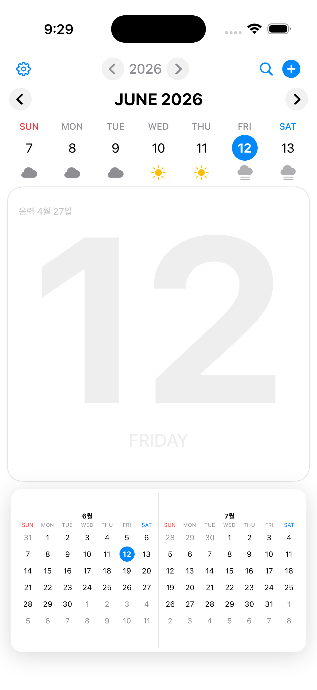

### 레이아웃

```
[⚙️]          < 2026 >          [🔍][➕]
  <  SUN  MON  TUE  WED  THU  FRI  SAT  >
       ☁️   ☁️   ☁️   ☀️   ☀️   🌤️   ☀️
┌────────────────────────────────────────┐
│ 음력 4월 27일                          │
│                                        │
│              1 2                       │  ← Hero 날짜
│                                        │
│             FRIDAY                     │
└────────────────────────────────────────┘
┌──────────────────┐  ┌──────────────────┐
│  6월 미니캘린더  │  │  7월 미니캘린더  │
└──────────────────┘  └──────────────────┘
```

### 상단 네비게이션

| 위치 | 요소 | 동작 |
|------|------|------|
| 좌측 | ⚙️ | 설정 시트 |
| 중앙 | `< 2026 >` | 연도 이동 |
| 우측 | 🔍 | 이벤트 검색 시트 |
| 우측 | ➕ (파란 원) | 이벤트 에디터 |

### 주간 스트립 (WeekStripView)

- 현재 주 7일 (SUN–SAT), `<` `>` 화살표로 주 이동
- 오늘 날짜: 파란 원 강조
- 각 날짜 아래 날씨 아이콘 (WeatherKit 연동)

### 히어로 날짜 섹션

- 선택 날짜 초대형 숫자 워터마크
- 음력 날짜 표시
- 요일 영문 표기 (FRIDAY)
- 해당 날짜 이벤트 목록 (MemoListView)

### 미니 캘린더

- 현재 월 + 다음 월 나란히
- 오늘: 파란 원, 선택일: 강조

### 제스처

| 제스처 | 동작 |
|--------|------|
| 날짜 탭 | 해당 날짜 선택 |
| 날짜 더블탭 | 이벤트 에디터 |
| 날짜 롱프레스 | 이벤트 에디터 |
| 히어로 좌우 스와이프 | 날짜 이동 |
| 주간 스트립 스와이프 | 주 이동 |

---

## 설정

### 기본 화면

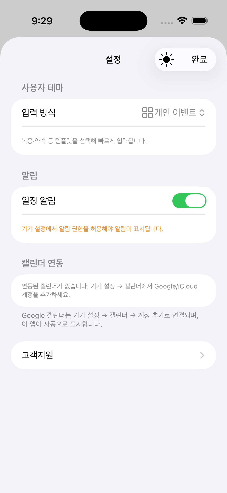

**상단 바:** 설정 타이틀 / ☀️ 색상모드 아이콘 (탭으로 system→dark→light 순환) / 완료

**사용자 테마:**
- 입력 방식: `개인 이벤트 ↕` — 탭하면 피커 표시

**알림:**
- 일정 알림 ON/OFF 토글 (녹색 = ON)
- 알림 권한 미허용 시 주황색 경고: "기기 설정에서 알림 권한을 허용해야 알림이 표시됩니다."

**캘린더 연동:**
- "연동된 캘린더가 없습니다. 기기 설정 → 캘린더에서 Google/iCloud 계정을 추가하세요."
- "Google 캘린더는 기기 설정 → 캘린더 → 계정 추가로 연결되며, 이 앱이 자동으로 표시합니다."

**기타:**
- 고객지원 >

### 입력 방식 피커

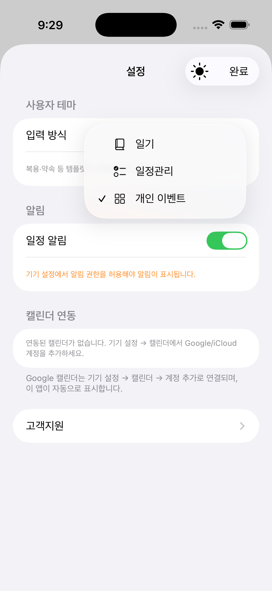

입력방식 행 탭 시 인라인 드롭다운 표시:
- 📓 일기
- ☰ 일정관리
- ✓ 品 개인 이벤트 (현재 선택)

---

## 고객지원

### 고객지원 메인

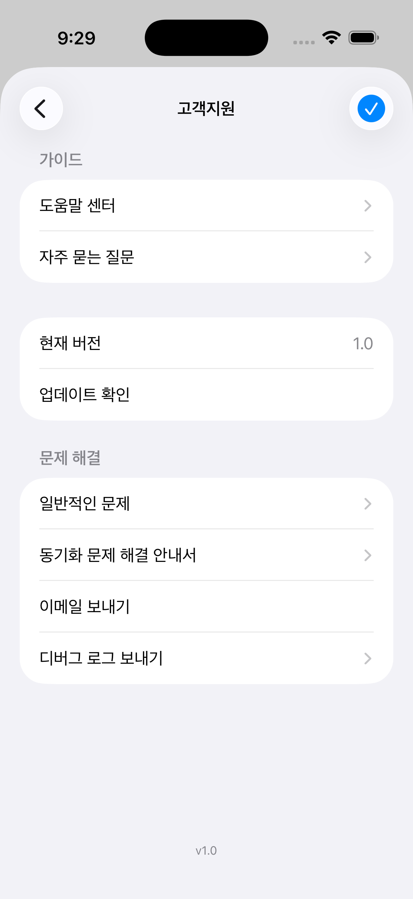

**상단 바:** `<` 뒤로 / 고객지원 타이틀 / ✓ (파란 원)

**가이드:**
- 도움말 센터 >
- 자주 묻는 질문 >

**앱 정보:**
- 현재 버전: 1.0
- 업데이트 확인

**문제 해결:**
- 일반적인 문제 >
- 동기화 문제 해결 안내서 >
- 이메일 보내기
- 디버그 로그 보내기 >

하단: `v1.0`

### 도움말 센터

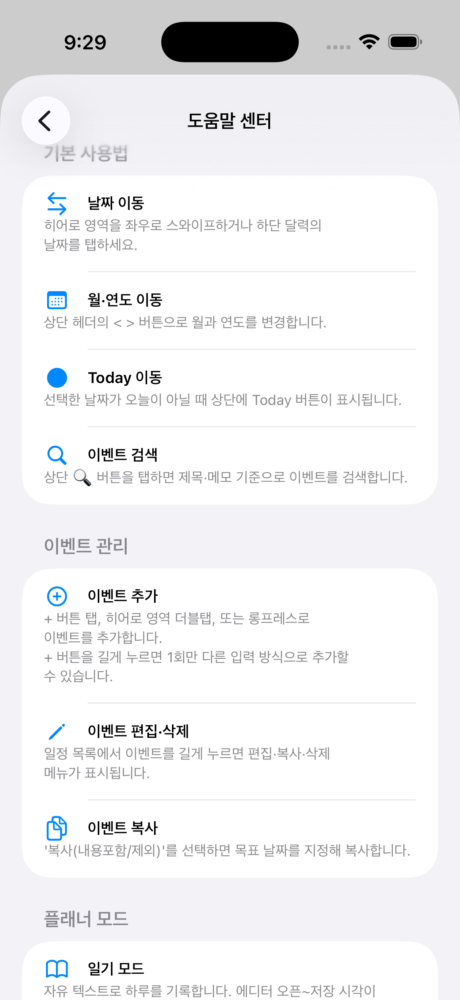

**기본 사용법:**
- **날짜 이동**: 히어로 영역 좌우 스와이프 / 하단 달력의 날짜 탭
- **월·연도 이동**: 상단 헤더 `< >` 버튼
- **Today 이동**: 선택 날짜가 오늘이 아닐 때 상단에 Today 버튼 표시
- **이벤트 검색**: 상단 🔍 버튼 → 제목·메모 기준 검색

**이벤트 관리:**
- **이벤트 추가**: ➕ 버튼 탭, 히어로 영역 더블탭, 롱프레스 / ➕ 롱프레스 시 1회만 다른 입력 방식 선택 가능
- **이벤트 편집·삭제**: 일정 목록에서 이벤트 롱프레스 → 편집·복사·삭제 메뉴
- **이벤트 복사**: '복사(내용포함/제외)' 선택 후 목표 날짜 지정

**플래너 모드:** (스크롤 영역 — 일기 모드 설명 포함)

### 자주 묻는 질문

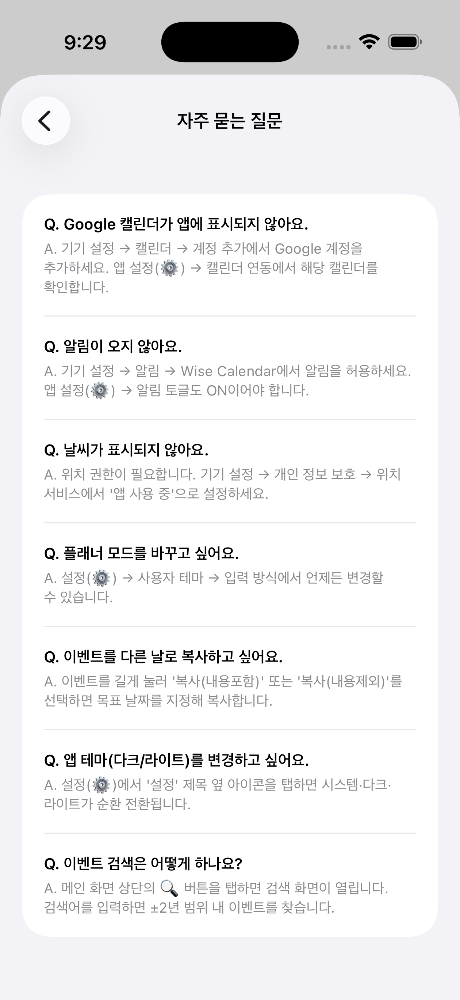

| 질문 | 요약 답변 |
|------|----------|
| Google 캘린더가 앱에 표시되지 않아요 | 기기 설정 → 캘린더 → 계정 추가 후 앱 설정 → 캘린더 연동에서 확인 |
| 알림이 오지 않아요 | 기기 설정 → 알림 → Wise Calendar 허용 / 앱 설정 알림 토글 ON |
| 날씨가 표시되지 않아요 | 위치 권한 필요, 기기 설정 → 개인 정보 보호 → 위치 서비스 → '앱 사용 중' |
| 플래너 모드를 바꾸고 싶어요 | 설정 → 사용자 테마 → 입력 방식에서 언제든 변경 |
| 이벤트를 다른 날로 복사하고 싶어요 | 이벤트 롱프레스 → 복사(내용포함/제외) → 목표 날짜 지정 |
| 앱 테마(다크/라이트)를 변경하고 싶어요 | 설정 상단의 ☀️ 아이콘 탭 → system·dark·light 순환 |
| 이벤트 검색은 어떻게 하나요? | 메인 화면 상단 🔍 탭 → 검색어 입력, ±2년 범위 이벤트 검색 |

### 일반적인 문제

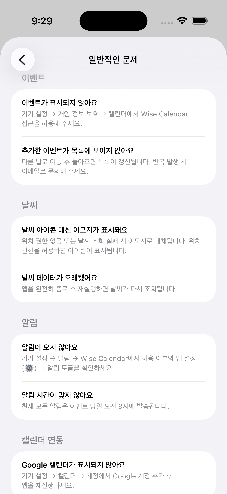

**이벤트:**
- 이벤트가 표시되지 않아요: 기기 설정 → 개인 정보 보호 → 캘린더에서 Wise Calendar 접근 허용
- 추가한 이벤트가 목록에 보이지 않아요: 다른 날 이동 후 돌아오면 갱신됨. 반복 발생 시 이메일 문의

**날씨:**
- 날씨 아이콘 대신 이모지가 표시돼요: 위치 권한 없거나 날씨 조회 실패 시 이모지로 대체
- 날씨 데이터가 오래됐어요: 앱 완전 종료 후 재실행

**알림:**
- 알림이 오지 않아요: 기기 설정 → 알림 → Wise Calendar 허용 여부 및 앱 설정 알림 토글 확인
- 알림 시간이 맞지 않아요: 현재 모든 알림은 이벤트 당일 오전 9시에 발송

**캘린더 연동:**
- Google 캘린더가 표시되지 않아요: 기기 설정 → 캘린더 → 계정 추가 후 앱 재실행

### 동기화 문제 해결

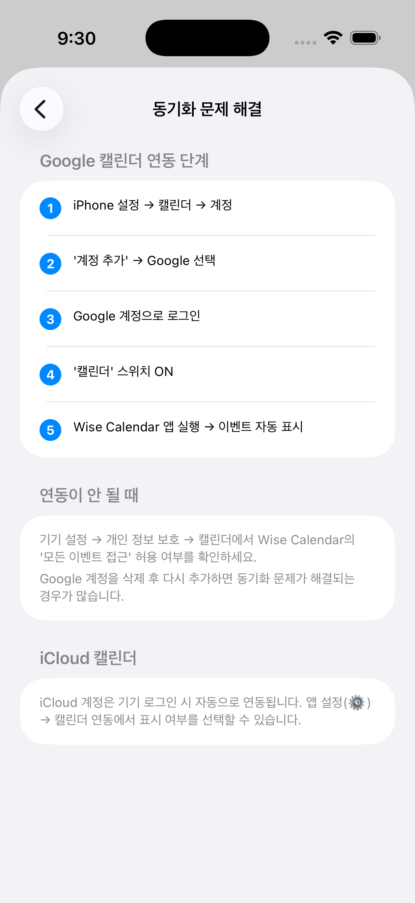

**Google 캘린더 연동 단계:**
1. iPhone 설정 → 캘린더 → 계정
2. '계정 추가' → Google 선택
3. Google 계정으로 로그인
4. '캘린더' 스위치 ON
5. Wise Calendar 앱 실행 → 이벤트 자동 표시

**연동이 안 될 때:**
- 기기 설정 → 개인 정보 보호 → 캘린더에서 Wise Calendar의 '모든 이벤트 접근' 허용 여부 확인
- Google 계정을 삭제 후 다시 추가하면 동기화 문제가 해결되는 경우 많음

**iCloud 캘린더:**
- iCloud 계정은 기기 로그인 시 자동으로 연동됨. 앱 설정 → 캘린더 연동에서 표시 여부 선택 가능

### 디버그 로그

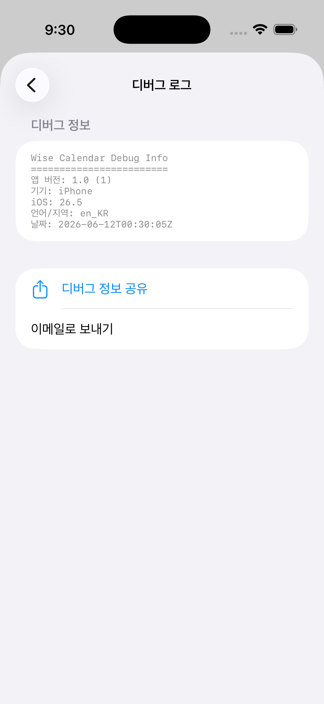

앱 환경 정보를 텍스트로 표시. 문의 시 첨부용.

```
Wise Calendar Debug Info
========================
앱 버전: 1.0 (1)
기기: iPhone
iOS: 26.5
언어/지역: en_KR
날짜: 2026-06-12T00:30:05Z
```

- **디버그 정보 공유** (공유 시트) / **이메일로 보내기**

---

## 이벤트 에디터

### 개인 이벤트 — 복용 탭

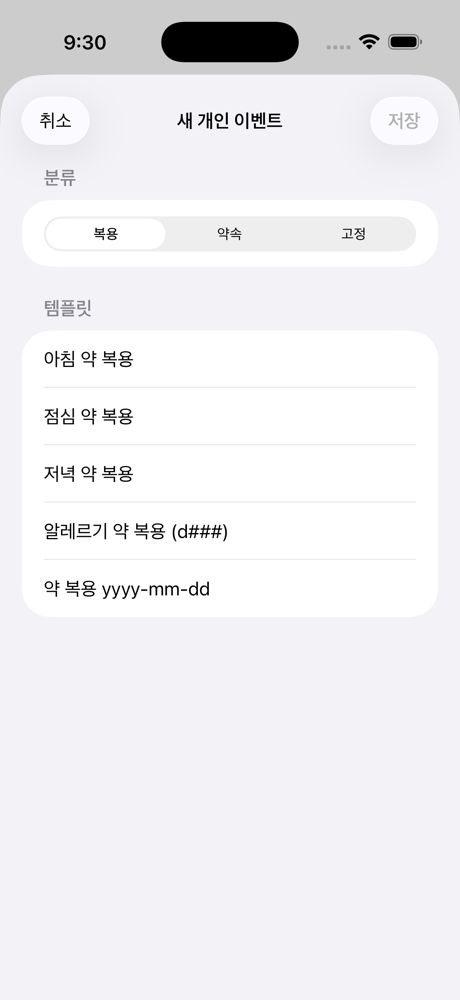

**내비게이션:** 취소 / 새 개인 이벤트 / 저장 (비활성)

**분류 세그먼트:** `복용` | 약속 | 고정

**템플릿 목록:**
- 아침 약 복용
- 점심 약 복용
- 저녁 약 복용
- 알레르기 약 복용 (d###)
- 약 복용 yyyy-mm-dd

### 개인 이벤트 — 약속 탭

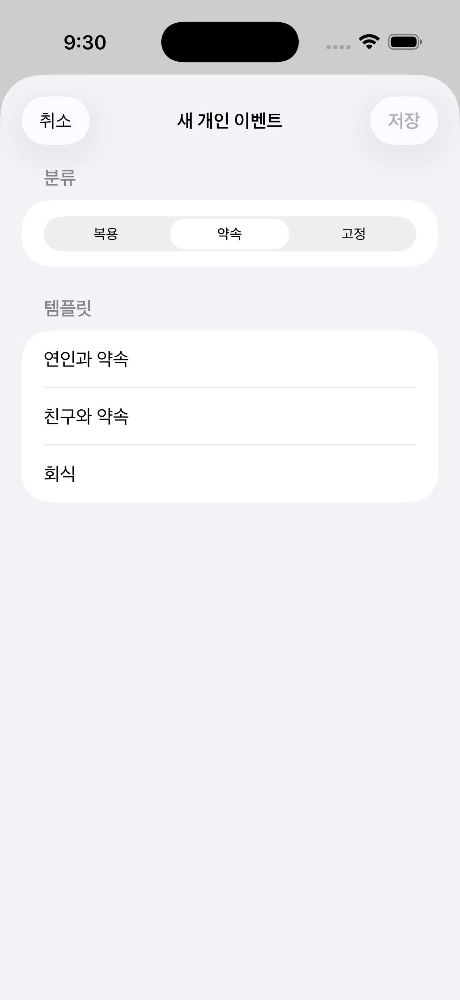

**분류 세그먼트:** 복용 | `약속` | 고정

**템플릿 목록:**
- 연인과 약속
- 친구와 약속
- 회식

### 개인 이벤트 — 고정 탭

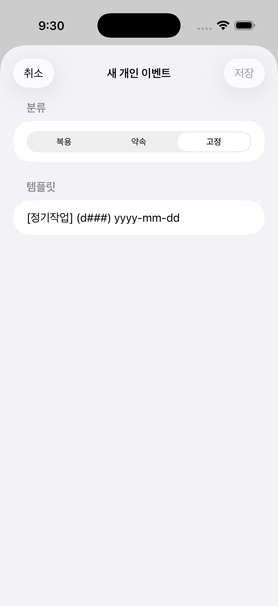

**분류 세그먼트:** 복용 | 약속 | `고정`

**템플릿 목록:**
- [정기작업] (d###) yyyy-mm-dd

---

## 1회 입력 방식 선택 (액션시트)

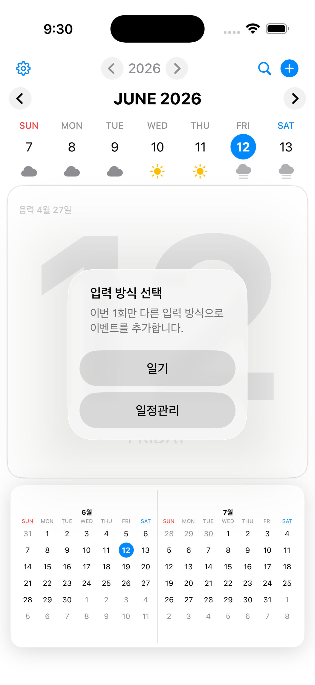

메인 캘린더에서 ➕ 버튼을 롱프레스하면 표시되는 액션시트.

> "입력 방식 선택  
> 이번 1회만 다른 입력 방식으로 이벤트를 추가합니다."

- **일기** → 일기 에디터
- **일정관리** → 일정관리 에디터

현재 모드(개인 이벤트)가 아닌 다른 방식으로 1회 입력할 때 사용. `settings.plannerMode`는 변경되지 않음.

---

## 일기 에디터

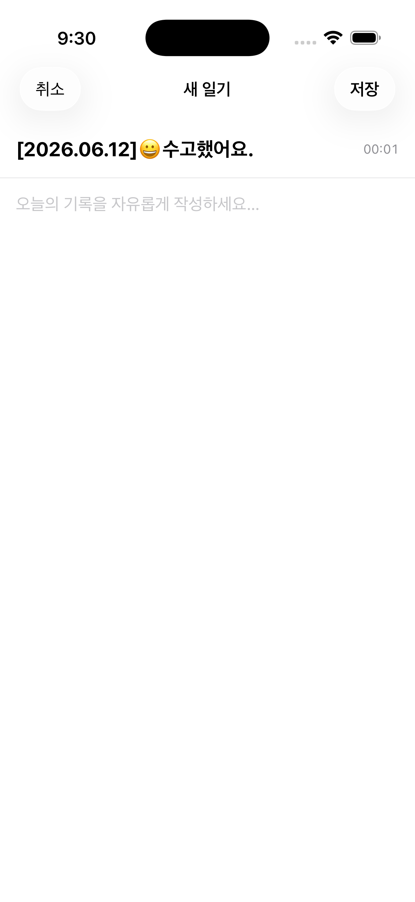

**내비게이션:** 취소 / 새 일기 / 저장

**특징:**
- `.fullScreenCover` 로 표시 (전체화면)
- 제목 자동 생성: `[2026.06.12]😀수고했어요.`
- 경과 시간 실시간 표시 (우상단, 00:01)
- 본문 placeholder: "오늘의 기록을 자유롭게 작성하세요..."

---

## 일정관리 에디터

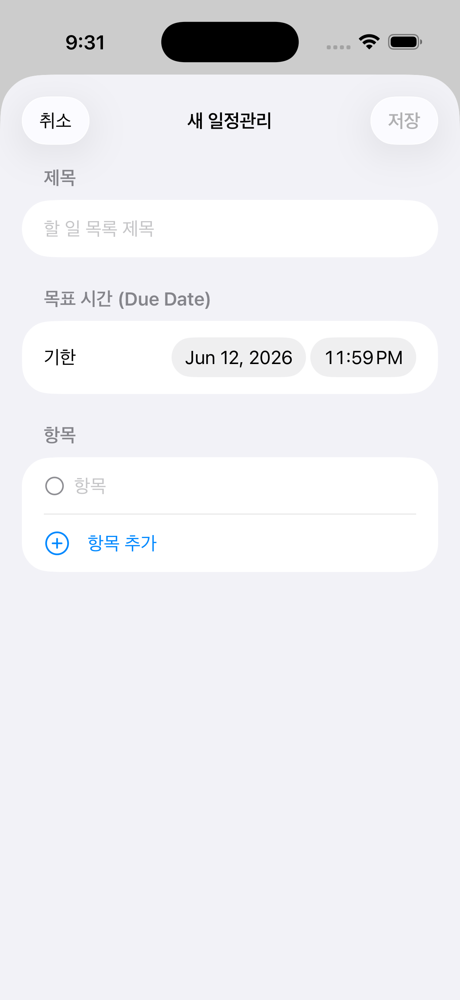

**내비게이션:** 취소 / 새 일정관리 / 저장 (비활성)

**입력 필드:**
- **제목**: placeholder "할 일 목록 제목"
- **목표 시간 (Due Date)**: 기한 날짜(Jun 12, 2026) + 시간(11:59 PM)
- **항목**: 빈 항목 1개 기본 표시 + "⊕ 항목 추가" 버튼

---

## 아키텍처 요약

```
RootView
  ├── .fullScreenCover → OnboardingView (최초/버전업)
  │    ├── 화면 1: 사용 방식 선택
  │    ├── 화면 2: 입력 모드 설명
  │    ├── 화면 3: 개인 이벤트 소개
  │    └── 화면 4: 연동 & 알림
  └── CalendarView (기본)
       ├── WeekStripView
       ├── 히어로 날짜 + MemoListView
       ├── 2× MonthView (미니 캘린더)
       ├── .sheet → SettingsView (⚙️)
       │    └── SupportView → HelpCenterView / FAQView / IssuesView / SyncGuideView / DebugLogView
       ├── .sheet → PersonalEventEditorView (개인이벤트 모드 ➕)
       │    └── 세그먼트: 복용 / 약속 / 고정
       ├── .fullScreenCover → DiaryEditorView (일기 모드 ➕)
       ├── .sheet → TodoEditorView (일정관리 모드 ➕)
       ├── ActionSheet → 1회 입력방식 선택 (➕ 롱프레스)
       └── .sheet → EventSearchView (🔍)
```

### 상태 관리 (AppSettings — UserDefaults)

| 키 | 타입 | 값 예시 |
|----|------|---------|
| `settings.plannerMode` | String | `diary` / `todo` / `personalEvent` |
| `settings.onboardingCompleted` | Bool | true |
| `settings.lastSeenVersion` | String | `"1.0"` |
| `settings.notificationsEnabled` | Bool | true |
| `settings.enabledCalendarIDs` | [String] | `[]` (전체) |
| `settings.appColorScheme` | String | `system` / `dark` / `light` |

### 온보딩 표시 조건

```swift
var shouldShowOnboarding: Bool {
    #if DEBUG
    return true   // DEBUG: 매 실행마다 표시
    #else
    return !onboardingCompleted || lastSeenVersion != currentBundleVersion
    #endif
}
```

### 외부 서비스

| 서비스 | 프레임워크 | 용도 |
|--------|------------|------|
| WeatherService | CoreLocation + WeatherKit | 주간 날씨 아이콘 |
| EventStoreManager | EventKit (EKEventStore) | 캘린더 읽기/쓰기 |
| NotificationManager | UNUserNotificationCenter | 이벤트 당일 오전 9시 알림 |

---

## 화면 전환 흐름

```
온보딩 1 → 2 → 3 → 4 ──[시작하기]──▶ 메인 캘린더
                                           │
              ┌────────────────────────────┤
             [⚙️]              [➕]        [🔍]
              │           ┌────┴────┐
            설정        탭     롱프레스
              │          │         │
            고객지원   에디터  1회 방식 선택
              │       (모드별)   │       │
          6개 하위뷰         일기   일정관리
```
